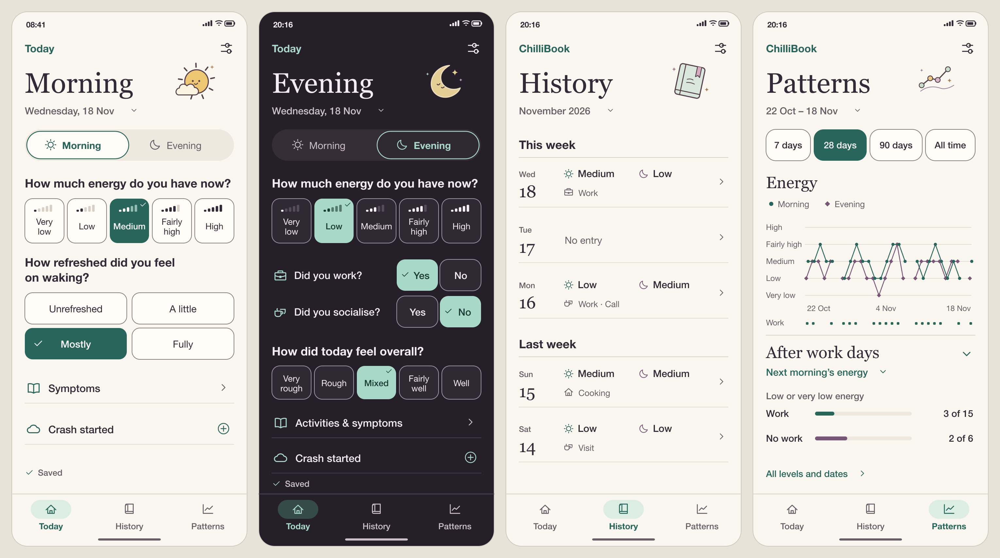

# ChilliBook · ME/CFS diary for Android

A private diary for one person balancing mild-to-moderate ME/CFS with work, socialising and household life. In the morning it should take two taps to say how the night went and how much energy is available. In the evening it should be just as easy to record a good visit with a friend as a difficult day at work. Months later, the person should be able to see what they enjoyed, what they could manage and how they felt afterwards.

The original design reference and milestone descriptions document the first release. Later sections describe changes through 1.7.

The **first release** is a privately installed Android app with offline check-ins, editable history, personal charts and a restorable backup. The two check-ins and emphasis on ordinary working life are the owner's choices. The labels, timings and visual palette below are starting points to try on their phone.

## UX and UI design direction

*Design reference with invented entries. The screens show morning check-in, evening check-in, history and patterns in reading order. Both check-ins support both themes.* [Open the full-size reference](UI_REFERENCE.png)

Build ChilliBook as a small illustrated diary. Give each screen one generous serif heading, warm paper, and clear sans-serif controls. The tiny sun peeking from behind a cloud and the resting crescent are the moments of playfulness. The energy choices keep the same neutral expression and order all day. Someone who feels very unwell should feel as welcome opening the app as someone having a good morning.

### How the screens should feel in use

| Surface | What the person sees and does |
|---|---|
| **Today · Morning** | Start with the date, sun, and a wide Morning / Evening switch. Put five energy choices in a single row at normal phone size. Use ascending marks and a word on each. Follow with four sleep choices in a two-by-two grid. A finger can land anywhere on a choice. Selecting an answer fills it with teal and adds a tick. It stays in place so the second question is easy to reach. |
| **Today · Evening** | Keep energy and overall wellbeing together at the top. Place the activity rows below these questions and inline symptoms below activities. Keep the tapped control in place when its selection changes. In the current release, tapping Yes reveals that category’s presets directly below the answer. |
| **History** | Use a week-by-week list. Give each day a narrow date column, then a sun and a moon with the two recorded energy labels. A second line holds the activity icons and words. “No entry” gets the same space and neutral colour as a recorded day. The whole row opens that date. A month picker reaches older entries without prolonged scrolling. |
| **Patterns** | Lead with one energy chart. Morning uses teal circles, evening uses plum diamonds, and missing days break the lines. Align work or other selected activity marks with the dates beneath the plot. Below it, make the factor and follow-up period selectable. Show two bars on the same scale with counts such as “3 of 15”. **All levels and dates** opens the full distribution, gaps and underlying entries. One recorded day shows one point. An empty chart offers a link to Today. |

Keep **Today**, **History** and **Patterns** in a fixed bottom bar. Preserve the selected date, slot and scroll position when returning from details. The date and settings controls have a 48 dp touch area even when their icons are small.

### The design system for Compose

| Role | Light | Dark | Application |
|---|---|---|---|
| Page / raised surface | `#FAF7F1` / `#FFFCF7` | `#241F29` / `#2E2933` | A continuous matte page. Reserve raised surfaces for choices and sheets. |
| Main / secondary text | `#322A37` / `#665D66` | `#F5EDF3` / `#CEC1CD` | Questions and values use main text. Dates and supporting text use secondary. |
| Selected fill / its text | `#28665B` / `#FFFFFF` | `#A8D8C7` / `#193B34` | A solid selected choice with a check. Unanswered Yes and No share an outline. |
| Control outline / divider | `#837B74` / `#E3DBD1` | `#A498A6` / `#493E4D` | Use the stronger outline for interactive choices and the quieter line for list rows. |
| Morning / evening data marks | `#28665B` / `#795576` | `#A8D8C7` / `#DAB3DA` | Repeat the same colours, shapes and series names on charts, legends and date details. |

- **Type and layout.** Use Android's local serif for screen titles (40–44 sp) and chart titles (24 sp), with Roboto or the system sans for questions (18–20 sp), answers (14–16 sp) and supporting labels (12–14 sp). Start with 20 dp page gutters, 8 dp between related controls and 24–32 dp between questions. Use 12–16 dp corners on answer tiles and a pill shape for the time-of-day switch. Theme Material 3 components with these roles and keep both themes available independently of the time.
- **Illustration and icons.** Use local vector drawables. Give the sun and moon a two-dot face, short rounded strokes and at most one small sparkle. Keep them still. Reuse the work bag, cups and house everywhere those activities appear, always with a label. A single illustration, about 64 dp wide, belongs in the header. It can disappear when large text needs its space.
- **Saving, correction and failure.** On a tap, keep keyboard and scroll position stable. The pressed control briefly compresses and settles into its selected state. A second tap on another option edits it. Offer Clear in the field's edit actions. On a failed write, retain the intended choice, show “Couldn’t save” with Retry, and announce the failure once. The detail sheet closes with Android Back and returns to the same place.
- **Access on a difficult day.** All controls have at least a 48 dp target. At large system font sizes, wrap the five-choice row into a grid, then a list if needed. Allow the body to scroll above the navigation bar. Keep visible labels intact and selections understandable in greyscale. Normal text needs at least 4.5 to 1 contrast. TalkBack reads the question, choice and selected state. Chart details also have a text view. Keep sound, vibration and decorative motion off by default. [Android accessibility guidance](https://developer.android.com/guide/topics/ui/accessibility/apps)

**Design acceptance.** During milestone 1, compare the running Today screen with both check-in references side by side. Verify one-tap saving, a two-tap morning and a four-tap evening. Try a narrow 360 dp viewport at 200% font scale and check that every answer can be read, selected and corrected. When History and Patterns land, use an empty date and a deliberately missing morning to check their respective empty states and chart gaps. Use synthetic entries in review screenshots. Adjust dimensions where Android needs them while preserving control order, legibility and tap count.

## The daily experience

Open directly to **Today**. Show the date and a **Morning / Evening** switch, with the likely slot selected by local time. Both slots are always available. Each answer saves immediately on the device. Confirm routine taps through the selected control. Tapping a different answer corrects it. Allow any answer to be cleared. Leaving after one tap counts as a complete interaction.

| On Today | Morning | Evening |
|---|---|---|
| First question | **How much energy do you have now?** Five labelled choices from Very low to High. | The same energy question and choices. This gives each day two comparable observations. |
| Next in reach | **How refreshed did you feel on waking?** Unrefreshed / A little / Mostly / Fully. | **Did you work?** and **Did you socialise?** Each has a visible Yes and No. Then **How did today feel overall?** Very rough / Rough / Mixed / Fairly well / Well. |
| When there is more to say | Select a symptom inline and optionally choose its severity. Yesterday evening is one date change away. | Use **What did you do?** for work, household tasks and socialising. **Other activities** covers activities such as walking and rest. Select symptoms on the same page. Context and changes to plans remain optional. |

The energy choices are **Very low / Low / Medium / Fairly high / High**, anchored to the person's own experience. Keep the words and order stable across screens and over time. “How did today feel overall?” is deliberately broader. Someone can report low energy and a lovely day. Leaving the sleep, work or wellbeing question unanswered is always a valid way to finish.

**Interaction target.** From Today, an ordinary morning takes two answer taps and an ordinary evening takes four, with no keyboard, slider, save button or mandatory follow-up. On a foggy day, one energy or symptom tap is enough. Keep edit, backfill and undo available after the moment has passed. Measure the ordinary paths on the owner's phone, aiming for about 10 seconds in the morning and 20 seconds in the evening, without imposing a timer.

### What goes behind the extra tap

| Record | First-version choices | How to interpret it later |
|---|---|---|
| Work | Yes or No. If Yes, optionally pick Full day / Part day, At home / On site / Both. Add a tag such as Meetings, Focused work or Commute. No completes the work answer. | A short remote shift and a full day with a commute can have quite different demands. |
| Social and household | Socialising includes phone or video calls, messages and time together in person. Offer short presets such as Call, Visit, Meal out. Household has its own Yes / No and presets such as Cooking, Laundry, Cleaning or Shopping. | Each category can coexist with the others. A family meal can involve cooking and a visit. Record an activity once and allow both tags. |
| Other everyday activity | Offer Personal care, Travel, Walking, Admin/screens, Quiet rest and Hobby. For any activity, optionally add duration (Under 15 min / 15–60 min / Over an hour), perceived effort (Light / Moderate / High) and demands (Physical / Thinking / Upright / Sensory / Emotional). | Record how demanding it felt to this person. A seated meeting may be cognitively demanding. Quiet rest is an activity the person can deliberately record. |
| Positive experience | Inside an activity, offer **Was this worthwhile to you?** Yes / Mixed / No. All three answers are optional. | Show the answer beside subsequent energy in History. The user can value a visit and still want to understand the following two days. |
| Common symptoms | Start with Brain fog and Heavy fatigue pinned. Also offer Muscle or joint pain, Headache, Dizzy when upright, Flu-like feeling and Light or sound sensitivity. Tap a symptom, then None / Mild / Moderate / Strong. Let the person change their pins. | Anchor Mild to “noticeable, I could carry on” and Moderate to “I had to adjust what I was doing”. Strong leaves room for an unusually bad day. An untouched symptom is unknown. These are personal diary ratings. |
| Effect on everyday life | Optional evening answer to **Did symptoms change your plans?** As planned / Slowed down / Dropped something / Needed help. Optional context chips include Intercurrent illness (“Fighting a bug”), Unusual stress and Change in medication. | A day with the usual work hours may still have cost someone the ability to cook dinner. These details help interpret a change in energy. |

Activity details can be added from Today or History. A Work, Social or Household tag counts as Yes for its day. Keep explicit answers separately so removing a mistaken tag restores the previous answer. If tags and a new answer conflict, show the relevant entries and let the user correct either. Unanswered flags start blank each day.

## What Patterns should actually calculate

1. **See the course of a week or several months.** Start with a 28-day view. Plot morning and evening energy separately with distinct shapes on the same five labelled levels. Show activity marks underneath. Break the series at missing slots. Offer 7 days, 90 days and All time. For long spans, switch to monthly distributions of the five levels, keeping AM and PM distinct and showing the count of recorded slots. Tap a month to see its days.
2. **Compare one chosen factor at a time.** Start with Work, Socialising or Household because each has explicit Yes/No answers. For each activity date D in the selected range, compare outcomes for Yes days and No days. Read the follow-up even if it falls just beyond that range. Default to morning energy on **the next calendar day**. Also offer two and three mornings later, plus same-evening energy or overall wellbeing. Use the original local diary dates. A two-day lag means D+2 even if D+1 was blank. Same-evening results describe co-occurrence because the order within the day can be unknown.
3. **Make the calculation visible.** On the overview, use two bars showing the fraction with Low or Very low energy (Rough or Very rough for wellbeing). Print the numerator and denominator. **All levels and dates** shows counts at every level for both groups and the contributing dates. Each anchor date contributes at most one pair per chosen lag and outcome. Count from the first diary date onwards. Include a recorded follow-up immediately. Count a missing follow-up only after its day has ended. Show usable and missing counts for each group, plus the number of days with unknown activity status. Keep future follow-ups out of the counts. Below five usable pairs in either group, show the raw dates and counts with “A few entries so far”. Five is a display choice, with no claim of statistical reliability.
4. **Read the result in context.** A card with invented data might say “Two mornings after socialising, you logged Low or Very low energy on 3 of 8 mornings. After days with no socialising, it was 2 of 10.” Open a contributing date to see its starting morning energy, sleep, overlapping work or chores, illness, and whether the visit felt worthwhile. Good mornings may make socialising possible, symptoms may prompt rest or time off, and hard days may be missing. Consecutive days can fall within the same crash. Show descriptive observations and leave activity decisions with the person.

**Look up a particular activity or symptom.** Selecting a tag such as Meetings, Cooking or Call shows a date list with that evening's wellbeing, the next two mornings' energy and any recorded value the activity had for the person. Unmarked dates cannot serve as a comparison group for optional tags. Let the timeline metric switch from energy to a pinned symptom, using its own severity labels and preserving missing observations.

**Example to build against.** On Monday the user records work, a worthwhile call and Medium evening energy. Tuesday is blank. On Wednesday they record Low morning energy. History shows the gap in Tuesday's energy. Monday contributes to the two-mornings-later comparison for both work and socialising when each is selected. It contributes nothing to the next-morning energy comparison. Its appearance on the timeline leaves the trigger open.

## Research behind the choices

Primary research reviewed in November 2026. Interviews inform which questions to ask, while repeated measurements inform when to look for changes. The short scales and logging-time targets are design choices to try with the owner.

| Evidence | Design consequence |
|---|---|
| Chu and colleagues surveyed 150 people with ME/CFS about PEM. Onset and duration varied. Some consistently experienced a delay of at least 24 hours, and symptom worsening often lasted at least a day. [PLOS One, 2018](https://journals.plos.org/plosone/article?id=10.1371/journal.pone.0197811) | Give same-day and delayed observations equal visibility. Retain the entire history for backdated comparisons. |
| Holtzman and colleagues' patient-driven survey of 1,534 respondents identified cognitive exhaustion, unrefreshing sleep, pain and dizziness, as well as sensory exposures and ordinary activities. Online recruitment limits how broadly symptom frequencies apply. [Diagnostics, 2019](https://www.mdpi.com/2075-4418/9/1/26) | Offer short, recognisable symptom and demand choices. Let the person pin the symptoms that change their day. |
| The patient-informed FUNCAP work covers eight areas of functioning, including being upright, concentrating, communicating and doing things at home. [Sommerfelt and colleagues, 2024](https://www.mdpi.com/2077-0383/13/12/3486) | Ask what the person had to change and capture cognitive and upright demands. The diary uses its own everyday prompts and produces no FUNCAP score. |
| Nine people completed detailed time diaries in an occupational therapy study. Participants described insight into meaningful activities and the effort it took to log half-hour blocks. [Roxburgh, Hughes and Milgate, 2024](https://journals.sagepub.com/doi/10.1177/03080226241249279) | Keep the two check-ins short. Make duration bands optional and preserve enjoyment or personal value alongside energy. |
| Interviews with ten employed people with ME/CFS in Kerala described fluctuating ability to sustain work and adjustments needed to remain employed. This is a small, setting-specific qualitative study. [Surendran and Jose, 2025](https://link.springer.com/article/10.1186/s12982-025-01036-0) | Include part days, work setting and a distinction between planned time off and illness absence. The specific chips are design choices for this user. |
| After a controlled exercise task, researchers followed 30 people with ME/CFS, 30 with post-acute COVID symptoms and 30 controls for a week. Changes in the combined symptom measure were greatest in the first 72 hours and individual responses varied. [Berardi and colleagues, April 2026 issue](https://doi.org/10.1249/MSS.0000000000003891) | Offer one-, two- and three-day views. A laboratory exercise response cannot set a timetable or safe activity threshold for an ordinary work day. |
| In a seven-day home study, 38 people with ME/CFS and 38 matched controls kept diaries and wore accelerometers. Sleep efficiency varied more from night to night in ME/CFS, even though total sleep time did not differ between groups. [Saurel and colleagues, May 2026](https://link.springer.com/article/10.1007/s44470-026-00079-7) | Ask how refreshed the person felt on waking. This captures their experience directly. It does not estimate measured sleep efficiency or require a watch. |

## Android implementation and ownership of the data

- **Stack.** Use a single Kotlin app module, Jetpack Compose with Material 3, screen-level ViewModels and a local Room database. Use stable dependencies compatible with the owner's phone. Read charts from the same saved entries as History. A small pure Kotlin function can group observations by factor and lag. The first release needs no account, server, analytics, wearable or internet permission. [Android architecture recommendations](https://developer.android.com/topic/architecture/recommendations)
- **Small data model.** Keep a day record keyed by local date for context and day-wide answers, and a check-in unique on (local date, AM/PM) for energy, waking refreshment and symptoms. Activities have stable IDs, a diary date, category tags and optional detail. Use stable IDs for scale choices and tags too. Store the original diary date separately from the recorded-at instant and time zone so travel, daylight saving and backfill never reassign an entry. Use nullable answers. Save each tap atomically, and make a retry update the same record. Export Room schemas and migrate existing diaries on upgrade. [Room migrations](https://developer.android.com/training/data-storage/room/migrating-db-versions)
- **Privacy and recovery.** Keep the database in app-private storage. Exclude the diary and preferences from Android's automatic cloud backup and device-transfer paths for supported OS versions. Avoid logging health values. In Settings, offer **Back up diary** and **Restore diary** through the Android file picker. Use a versioned JSON file that preserves IDs, unknowns, settings. Clearly label it as readable health data and explain that the chosen destination may sync. Validate before writing, preview date range and record counts, and ask before replacing an existing diary in one transaction. A cancelled or invalid restore leaves the original intact. [Android backup rules](https://developer.android.com/identity/data/autobackup) · [Android document picker](https://developer.android.com/training/data-storage/shared/documents-files)
- **Private installation.** Use an emulator or a debug build with synthetic entries during development. For the owner's diary, deliver a release APK with a stable application ID and a user-controlled signing key stored and backed up outside the repository. Install directly over USB using ADB. Update in place with the same ID and signing key and a higher version code. Record the install/update commands when the build exists. [Android app signing](https://developer.android.com/studio/publish/app-signing) · [Android's guidance on private ADB installs](https://developer.android.com/developer-verification/guides/faq)

## Build order for the next session

| Milestone | Deliver and verify |
|---|---|
| **1 · Persistent morning and evening check-ins** | Scaffold the app. Implement Today's date selector, the two slots, energy, waking refreshment, work, socialising and overall wellbeing. Use real local persistence from the first tap. On an emulator, log only morning energy, close and reopen, finish the evening in four taps, then correct yesterday without creating a duplicate. |
| **2 · Editable history and recovery** | Add optional activities and symptoms, functional impact, editable History, backup and restore. Verify a partial day, explicit No and a selected but unrated symptom survive an export/restore round trip. Confirm that a damaged backup cannot erase an existing entry. Prepare the signed build before collecting real entries. |
| **3 · Timelines and comparisons** | Build the timeline, month summaries, activity lookup and one-factor comparisons. Exercise the Monday–Wednesday example above, sparse groups and a year of synthetic entries. Verify a displayed group count against its list of dates. Read the result with TalkBack. |
| **4 · Private installation and final check** | Produce the signed APK. Verify a same-key update preserves a synthetic diary and the backup restores it. Walk through both check-ins and a comparison on the emulator or available phone. Report the build path, installation steps, devices actually used and any owner-only checks remaining. |

## Goal-mode handoff

**Suggested goal for the new session**

> Build and verify the private Android release described in PROJECT_PLAN.md. Follow AGENTS.md and the visual reference. Deliver the morning and evening check-ins, editable history, personal charts, backup and restore, and a privately installable signed APK. Work through all four milestones. Use focused low-reasoning sub-agents for independent coding tasks. At handoff, show the running screens, provide the APK path and install/update steps, and state what you verified.

Milestone 1 is the first working build. Agree the day/slot contract, delegate storage and the Today screen against it, then integrate and run the close/reopen and edit flows. For a full-release goal, continue through the remaining milestones in the same session. If the owner specifies a narrower goal, its stated scope takes precedence.

**Using this Mac.** Android Studio is installed, the SDK includes Android 37.0, and a Medium Phone virtual device is configured. Recheck the available runtime when building. From the project, try the Gradle wrapper and list available ADB devices. If Android Studio would help, the owner can open the project and launch the existing phone from Device Manager. Use Compose Preview to adjust type, spacing and theme quickly, then verify saving, navigation and chart behaviour on a running emulator or connected phone. If device access or owner-managed release signing needs input, request the specific action and continue independent work. [Compose Preview](https://developer.android.com/develop/ui/compose/tooling/previews) · [Android Device Manager](https://developer.android.com/studio/run/managing-avds)

**After handoff.** After a few days of ordinary use, ask which tap felt expensive, which label missed the person's experience and which detail they wanted on a chart. This feedback can guide a later session. Reminders, sensors and additional reports can wait for that feedback.

## Improvements after the first phone trial

| Priority | Improvement | Acceptance |
|---|---|---|
| 1 | Automatic updates that preserve the diary | Install the next signed APK over 1.0. Opening the database applies a transaction and retains every existing field. The owner can go straight to Today. |
| 2 | Stable symptoms, activity and crash sheets | Scroll to either end repeatedly at ordinary and large font sizes. The sheet and its Done or Back control stay still while the list scrolls. Returning from a rating restores the list position. |
| 3 | Clearer selection and touch feedback | Leave room between a tick, the outline and the answer. A press changes the fill in place, a cancelled press clears it and a completed tap shows its selection. Keep the interaction silent and vibration-free. |
| 4 | Optional check-in reminders | Offer independent morning and evening switches and local times. Both start off. Request permission when a reminder is enabled, handle denial, and open the intended check-in on tap. Suppress an answered slot, including an evening recorded only as No. |
| 5 | Activities and symptoms in Patterns | Show activity frequency by distinct day and symptom severity by morning and evening. Label unrecorded observations separately and open the dates behind a count. Apply the current date range throughout. |

Further candidates for the next phone trial are a History filter for a particular activity or symptom, a yesterday shortcut for backfilling, and pinning frequent activity tags alongside pinned symptoms. Prioritise these by the taps they save in ordinary use.

### Update contract and rehearsal

Version 1.0 shipped Room schema 1 and JSON export format 1. Version 1.1 introduces two nullable reminder times on the preferences row. Room generates the 1 → 2 migration from the retained schemas. A null time means the reminder is off. Existing diary tables retain their original schema. The export reader accepts formats 1 and 2 and supplies the same defaults for older exports.

For each future database change, keep the previous schema files, decide how every existing value maps, add the migration to the production database, and include a regression using the released schema. For ambiguous changes such as splitting a field, write the SQL or Kotlin mapping explicitly. Run the supported upgrade paths, including a skipped release, and compare migrated entries with expected entries. A failed open must leave the original data available for a corrected build and retry.

For each signed release:

1. On an isolated test emulator, populate the previous signed release with a synthetic diary that includes partial entries, explicit No, unanswered symptoms, multi-tag activities and settings. For upgrades from earlier schemas, include populated retired fields to exercise their removal.
2. Export a comparison fixture from the old test app. Install the candidate with the same signing identity, application ID and a higher version code using the ordinary Update flow. Open directly into the diary.
3. Export from the updated test app and run `python3 scripts/compare-upgrade.py BEFORE.json AFTER.json`. Check that a subsequent edit persists across reopening. The exports in this rehearsal are developer test evidence. The owner's update requires only the APK.
4. Run the Room migration and rollback tests in `DiaryMigrationTest`, and test the old JSON format separately from the database upgrade. For a release with new permissions, verify that the existing diary remains usable when permission is denied.

## Open-source distribution and evening activities · 1.2

- Publish source in `mikeritch/ChilliBook` and attach the signed production APK to each stable GitHub Release. The tag, asset name and Android version name agree, for example `v1.2` and `ChilliBook-1.2.apk`. See [the release guide](RELEASE.md).
- The user initiates every network operation from Settings. Check GitHub's public latest-release metadata over HTTPS. Download on request, verify the asset digest, application ID, signer and higher version code, then hand the private file to the Android installer for confirmation. Diary features and reminders continue offline.
- Put work, socialising and household answers next to the evening's activities. One activity can have several tags. Tapping Add opens one editor in the evening view, with grouped presets and optional details. Each choice saves immediately. Opening and closing an empty editor leaves the diary untouched.
- Keep existing entry IDs, timestamps, tags and optional fields. A tagged entry supplies its category's Yes answer. An explicit No remains meaningful after removing a mistakenly added tag. History edits use the same editor. Room and backup schemas remain at version 2 for this release.

## Activities and permanent reset · 1.3

Work, Household tasks and Socialising accept an explicit Yes or No. Yes saves independently and reveals that category’s activities. Each plus selects one activity for that day. A selected activity shows a red minus and its optional details open inline. Removing the selection preserves the category answer. Undo restores the entry and its details. Other activities offers everyday presets and a write-in without requiring a day-level answer. The evening editor in History follows the same flow.

Preserve the identity and details of existing entries, including combined activities, repeats and entries recorded with details alone. An update must never collapse older records to fit a toggle. Charts use the same recorded dates and unanswered-day rules as before.

Settings provides a permanent on-device reset behind two warnings. Confirming resets entries, preferences and reminders. Cancelling at either step preserves the diary. Exported backups belong to their chosen destination.

## Check-in interaction and retired fields · 1.4

Use space between sections, softly filled controls, and illustrated question headings. Ordered scales move from rose and amber to green and teal, with a tick, text and energy bars available independently of colour. A press and a brief selection pulse stay within the control’s layout. Preserve actionable save errors and Undo.

Morning and evening each have their own inline symptom toggles. Selecting a symptom records its presence immediately. Tapping a severity records the rating; tapping the same severity again clears just the rating. Remove the symptom with its minus. Undo restores its previous rating. History and Patterns distinguish unrecorded, recorded without severity, and explicit None.

The 1.4 migration retires crash episodes and the reason for a No work answer. Keep the work flag, check-ins, activities, personal settings and other day fields. Room schema 3 drops only the retired fields. Format 3 backups omit them, and the reader imports the remaining fields from formats 1 and 2.

## Check-ins, History and Patterns · 1.5

Select and clear energy, waking refreshment and wellbeing in place. Use centred labels, graded fills and a short, silent response to a tap. The night palette uses deep indigo surfaces with bright mint and lilac accents. Use a larger lightning bolt for energy.

Retire symptom pins, the separate answer editor and the evening question about changes to plans. Keep existing answers to that question in History and exports. Room schema 4 removes the pin preference. Backup format 4 retains import support for formats 1–3.

History shows the two previous dates, the next morning and the morning after, each with its own dated section. Keep gaps and future dates explicit. Patterns plots morning and evening across the full 90 days. All time shows monthly distributions for longer spans. Offer all known symptoms as timeline metrics. Show recorded days for each activity together. Selecting one opens its weekday breakdown and the dates behind it.

## Work, backfilling and finding entries · 1.6

Work Yes saves on its own. On the same screen, optionally select Commute, Meetings or Focused work, and record one day length, effort and set of demands for the whole work day. Place one pin button inside expanded Work. Save the entire setup, apply it to another date, replace it explicitly or unpin it. Subsequent changes to a diary entry and its saved setup are independent. Each named household, social or Other activity also has a pin in its own editor. Save its duration, effort, demands and worthwhile answer together. Keep pinned custom names available when their last diary entry is removed.

Keep historical activities and their individual settings, durations and worthwhile answers accessible. Room schema 5 marks newly grouped work entries and adds preferences for the Work pin and the individual activity pins. Backup format 5 includes both additions and reads formats 1–4. Keep the original IDs, diary dates, timestamps, fields and mixed tags during migration.

Place Yesterday beside the date on both check-ins and offer Today when backfilling. History searches recorded symptoms, activities and positive category answers across all months. Use cool lavender pages with pastel rose, periwinkle and mint controls in light mode. Show a roomy outline bolt with two eyes and a smile in the energy question.

## Activity frequency grid

Group related activities in rows and count distinct local diary dates in each column. Use daily columns for seven days, four successive weeks for the 28-day range, and calendar months for longer spans. The first and last columns respect the selected date limits. A dash means the period has no diary entries. Zero means the diary has coverage but the activity was never recorded there. Preserve explicit category No answers.

Selecting a count opens its dates directly under the activity row. For each date show evening wellbeing and energy on the next two calendar mornings, including mornings outside the selected week or month. Distinguish missing answers from future dates. A date opens its History entry.

## Date switching and day completion

Tap the displayed date beneath Morning or Evening to open the calendar. Choosing a date keeps the current check-in slot.

When a saved edit completes both check-ins, celebrate with a silent, full-screen flower bloom, sparkles and falling petals. Let taps pass through the effect. Leave the open flower and thank-you in the check-in header until the next local calendar day, even after closing the app. An explicit No counts and backfilling earns the reward on the day of the edit. Reopening shows the earned flower without replaying the burst. With animations disabled, go directly to the open flower. Keep this display state local to the installation and clear it on reset or restore. No diary or backup schema migration is needed.

## Rest and naps · 1.7

Place Rest & naps after Socialising and before Other. Each tap of Add rest or Add nap immediately records a separate episode. Open its optional time of day, duration and energy afterwards inline. Allow correcting the type, changing or clearing details, removing one episode, and undoing removal. An explicit day without rests is an evening answer. An unanswered day stays unknown.

Show original Quiet rest entries alongside new episodes. Preserve their IDs, timestamps, mixed tags, repeated entries, original duration ranges, effort, demands, worthwhile answers and saved setups. Room schema 6 adds nullable fields and leaves the original rows intact. Backup format 6 reads earlier versions. History shows individual episodes; the activity frequency grid counts distinct dates.

## Medication diary · 1.8

The owner approved this design on 18 November 2026. Today handles dose logging, History keeps dated medication changes, and Patterns shows what the diary recorded around each change.

**Today.** Show the scheduled doses for the selected date and check-in. One tap saves Taken or Skipped, even as the only answer. Leave untouched doses unanswered and allow clearing a mistaken answer. Add an as-needed dose in one tap after choosing the medicine. Each tap on Add dose records a distinct occurrence. Time, amount and reason are optional. Let the owner correct or remove one occurrence without changing another. Medication tracking is optional throughout.

**Current and past medicines.** In Manage medicines, allow a name alone and offer optional strength, amount, unit, schedule, start date and stop date. Support ongoing courses and backfilling finished courses. Keep uncertain dates and doses unknown. A change of dose or schedule takes effect on the chosen local date. Stopping a course ends future prompts, and restarting creates a separate course. Only generate prompts for dates covered by a known schedule. Recording an old course supplies context without filling in doses as taken.

**History.** Keep stable IDs for courses, dated regimens and individual dose records. Retain the dose and schedule recorded at the time of each answer. On a past date, distinguish the scheduled dose from what the owner recorded, show repeated as-needed doses separately and use the Today controls for corrections. Editing a historical answer changes only that occurrence. A later regimen edit preserves earlier observations.

**Patterns.** Select a medicine and a dated start, change or stop. Show morning and evening energy and the selected symptom on dates before and after the change. Selecting a date opens its observations and the next two calendar mornings, with gaps and future dates visible. Show recorded versus eligible observations for each period and the dates behind each count. Keep unrated symptoms distinct from explicit None. Surface overlapping medication changes, recorded work, activity and rest alongside the comparison. For as-needed doses, show the recorded reason where available since symptoms can prompt use. Describe what was recorded and when. These comparisons cannot establish whether a medicine helped or caused a change.

**Upgrade and acceptance.** Add medication tables in Room schema 7, retain the released schemas and register the additive 6 → 7 migration. Existing diaries start with empty medication tables. Export format 7 includes courses, dated regimens and dose records. Read formats 1–6 with empty medication data. Validate versions and references before replacing the diary. Exercise a populated 1.7 signed in-place upgrade and a skipped-version migration using the rehearsal above. Check an unknown-dose past course, a dose change, Taken, Skipped, an unanswered dose and two same-day as-needed doses. Correct the earlier Taken answer, reopen and round-trip the backup. Compare IDs, dates, amounts, unknowns, answers and repeat counts, and verify existing diary entries and settings. Check that a failed migration is retryable and that a damaged or unsupported backup leaves the diary intact.

## Scheduled dose defaults and action buttons · 1.8.1

Place Medications immediately below Symptoms in both check-ins. Preselect Taken for a due scheduled dose. Label the default “Assumed taken” and derive it from the regimen for that date and slot. An explicit Taken or Skipped overrides it. Clearing the explicit answer restores the default. Keep as-needed doses manual. Display the same distinction in History and Patterns. Viewing a schedule leaves the diary, reminders and check-in completion state untouched. Give standalone actions such as Manage medications a visible button shape.

## Medication patterns · 1.9

Open the latest medication change directly, or the selected course from History. Use one Switch action for dated changes and as-needed courses. For scheduled changes, compare two calendar weeks, leading with a plain-language observation and tappable daily readings. Opening a date shows the dose, diary context, and the next two dated morning entries. For as-needed medication, open the list of actual dose days directly. Keep repeat doses, uncertain status, missing readings and future follow-ups distinct. Use the existing diary on device.

## Patterns overview · 1.10

Choose 7 days, 28 days, 90 days or All time from the dropdown beside Patterns. Keep the historical end date selectable. Lead with morning and evening energy on the same scale. Use daily readings for 7 and 28 days, weekly medians for 90 days and All time, and preserve gaps. View daily readings opens the original calendar dates.

For each activity, compare low readings that evening and on the next two calendar mornings. Select activity dates inside the chosen range and use any available follow-up readings, including ones beyond its end. Show the recorded denominator on each tile. Pair morning and evening symptom bars on the same scale and count moderate or strong ratings among severity-rated observations. Tap either comparison to open its dates. Keep the full activity frequency and symptom distributions accessible.

For medications, plot the diary measure across a dated change or mark actual as-needed dose days. Use the same course, measure and selected period when opening the detailed comparison. Retain the medication history shortcut and distinguish the final day of a course from its first day off.
