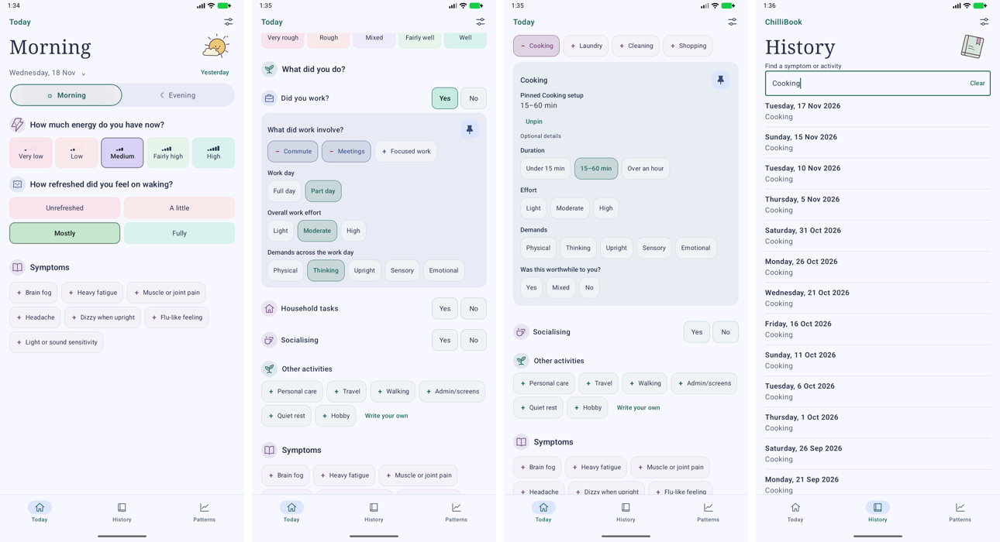

# ChilliBook

ChilliBook is an Android diary for people living with ME/CFS. A single answer saves a check-in. Record morning and evening energy, symptoms and activities, edit past dates, and explore personal patterns over time. Morning and evening reminders are optional.

[Download the signed APK](https://github.com/mikeritch/ChilliBook/releases/latest) · [Installation and release guide](RELEASE.md)

## Privacy and updates

Your diary lives in a local Room database. Check-ins, charts and reminders work offline. ChilliBook contacts GitHub when you choose to check for or download a release. GitHub receives ordinary download request information such as the IP address. JSON backups contain readable health data.

**Share to AI App** prepares a preview on your phone from the selected 7, 28 or 90 days. You can copy the text or choose a receiving app through Android’s share sheet. The shared text contains personal diary data and is handled by the receiving app.

The Android installer asks you to confirm updates. Keep the app installed to preserve the diary. ChilliBook migrates its stored data automatically as needed.

## Build

Open this project in Android Studio with Android SDK Platform 37 installed, or run `./gradlew :app:assembleDebug` using JDK 17 or the JDK bundled with Android Studio. Debug builds use a separate application ID. Official releases use a private signing key.

[Product and design plan](PROJECT_PLAN.md) · [Contributor instructions](AGENTS.md)

## License

ChilliBook is distributed under the GNU General Public License, version 3 (GPL-3.0-only). See [LICENSE](LICENSE).
